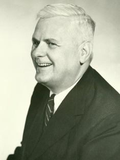
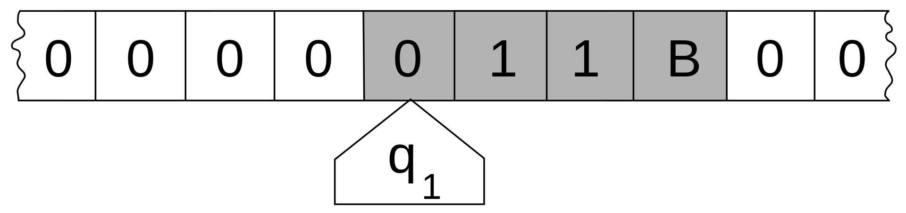

# 람다 계산

[일급 함수](./first-class-functions.md) 장에서 우리는 함수를 값처럼 다루는 언어 FVAE를 만들었습니다. FVAE에는 숫자, 덧셈과 곱셈, 변수 정의(`val`), 함수, 함수 호출이 있었지요. 그런데 이 기능들이 정말 전부 필요할까요? 어떤 기능은 다른 기능으로 흉내 낼 수 있지 않을까요?

이 장에서는 두 가지를 배웁니다. 먼저 다른 문법으로 표현할 수 있는 문법인 **문법 설탕(syntactic sugar)** 과, 그것을 걷어내는 변환인 <a id="g-desugaring"></a>**설탕 제거(desugaring)** 를 살펴봅니다. 그다음 이 생각을 끝까지 밀어붙여, 변수와 함수와 함수 호출만 남긴 아주 작은 언어인 <a id="g-lambda-calculus"></a>**람다 계산(lambda calculus)** 에 도착합니다. 놀랍게도 이 작은 언어만으로 숫자와 참·거짓, 나아가 컴퓨터가 할 수 있는 모든 계산을 표현할 수 있습니다.

이 장에서 만들 `FAE` 인터프리터를 먼저 돌려 봅시다. 프로그램을 고쳐 가며 실행해 보세요.

<div class="playground" data-lang="FAE"></div>

## 문법 설탕

### `val`이 꼭 필요할까?

다음 FVAE 식을 봅시다.

```fvae,run
/* FVAE */
val x = 1; x + 2
```

이 식은 **변수** `x`에 **값** `1`을 대입한 뒤, 환경 \\( [\texttt{x} \mapsto 1] \\) 아래에서 **몸통 식** `x + 2`를 계산합니다. 결과는 `3`입니다.

이번에는 다음 식을 봅시다.

```fvae,run
/* FVAE */
(x => x + 2)(1)
```

이 식은 익명 함수 `x => x + 2`를 만들고 곧바로 인자 `1`로 호출합니다. 즉 **매개변수** `x`에 **값**(인자) `1`을 대입한 뒤, 환경 \\( [\texttt{x} \mapsto 1] \\) 아래에서 **몸통 식** `x + 2`를 계산합니다. 설명을 한 줄씩 비교해 보면 앞의 식과 완전히 똑같습니다.

일반적으로 다음 두 식은 서로 같습니다.

\\[
\texttt{val}\ x\ \texttt{=}\ e_1;\ e_2
\qquad \text{는} \qquad
(\lambda x.e_2)(e_1)
\qquad \text{와 같다.}
\\]

왜 그럴까요? 두 식의 의미(semantics)를 정하는 추론 규칙을 나란히 놓아 보면 알 수 있습니다. 먼저 `val`의 의미는 다음 규칙으로 정했습니다.

\\[
\begin{prooftree}
\AxiomC{$\sigma \vdash e_1 \Rightarrow v_1$}
\AxiomC{$\sigma[x \mapsto v_1] \vdash e_2 \Rightarrow v_2$}
\LeftLabel{$\texttt{Val}$}
\BinaryInfC{$\sigma \vdash \texttt{val}\ x\ \texttt{=}\ e_1;\ e_2 \Rightarrow v_2$}
\end{prooftree}
\\]

한편 익명 함수와 함수 호출을 조합한 \\( (\lambda x.e_2)(e_1) \\)의 증명 나무는 항상 다음 모양입니다. 함수 부분은 `Fun` 규칙에 따라 클로저 \\( \langle \lambda x.e_2, \sigma \rangle \\)가 되고, 이 클로저를 호출하면 `App` 규칙에 따라 클로저가 기억하는 환경 \\( \sigma \\)에 \\( x \mapsto v_1 \\)을 더해 몸통을 계산합니다.

\\[
\begin{prooftree}
\AxiomC{}
\LeftLabel{$\texttt{Fun}$}
\UnaryInfC{$\sigma \vdash \lambda x.e_2 \Rightarrow \langle \lambda x.e_2, \sigma \rangle$}
\AxiomC{$\sigma \vdash e_1 \Rightarrow v_1$}
\AxiomC{$\sigma[x \mapsto v_1] \vdash e_2 \Rightarrow v_2$}
\LeftLabel{$\texttt{App}$}
\TrinaryInfC{$\sigma \vdash (\lambda x.e_2)(e_1) \Rightarrow v_2$}
\end{prooftree}
\\]

`Fun` 규칙은 전제가 없으므로 언제나 성립합니다. 그 부분을 빼고 나면 남는 전제는 \\( \sigma \vdash e_1 \Rightarrow v_1 \\)과 \\( \sigma[x \mapsto v_1] \vdash e_2 \Rightarrow v_2 \\) 두 개뿐이고, 이는 `Val` 규칙의 전제와 정확히 같습니다. 결론의 값도 똑같이 \\( v_2 \\)입니다. 따라서 두 식은 언제나 같은 값으로 계산됩니다.

### FAE: FVAE에서 `val` 빼기

`val`을 함수와 호출로 바꿔 쓸 수 있으니, `val`이 없는 더 작은 언어를 정의할 수 있습니다. 이 언어를 **FAE**라고 부릅니다.

\\[
\begin{array}{lrcll}
\text{Expressions} & e & ::= & n & (\texttt{Num}) \\\\
& & \mid & e\ \texttt{+}\ e & (\texttt{Add}) \\\\
& & \mid & e \ast e & (\texttt{Mul}) \\\\
& & \mid & x & (\texttt{Id}) \\\\
& & \mid & \lambda x.e & (\texttt{Fun}) \\\\
& & \mid & e(e) & (\texttt{App})
\end{array}
\\]

FVAE의 문법에서 `val`만 뺐을 뿐입니다. 사라진 `val`은 앞에서 본 동치 관계로 언제든 되살릴 수 있습니다. 앞으로 이 책의 여러 언어는 FAE를 바탕으로 기능을 하나씩 더해 가며 만들어집니다. 그러면서도 예제를 읽기 쉽게 `val`은 계속 쓸 텐데, 그럴 수 있는 이유가 바로 다음 절의 설탕 제거입니다.

### 문법 설탕과 설탕 제거

다른 문법 요소로 표현할 수 있는 문법 요소를 **문법 설탕**이라고 부릅니다. 커피에 넣는 설탕처럼, 없어도 되지만 있으면 프로그램을 쓰고 읽기가 훨씬 달콤해진다는 뜻입니다. 그리고 문법 설탕을 걷어내는 번역을 **설탕 제거**라고 합니다. 설탕 제거는 식을 받아 식을 돌려주는 함수입니다.

\\[
\mathcal{D}⟦ - ⟧ : \mathbb{E} \to \mathbb{E}
\\]

예를 들어 `val`의 설탕 제거를 다음처럼 정의해 볼 수 있습니다.

\\[
\mathcal{D}⟦ \texttt{val}\ x\ \texttt{=}\ e_1;\ e_2 ⟧ = (\lambda x.e_2)(e_1)
\\]

이 정의는 맞을까요? 아쉽게도 **틀렸습니다.** 다음 예를 보세요.

\\[
\mathcal{D}⟦ \texttt{val}\ \texttt{x}\ \texttt{=}\ 1;\ 2\ \texttt{+}\ (\texttt{val}\ \texttt{y}\ \texttt{=}\ 3;\ \texttt{x} \ast \texttt{y}) ⟧
= (\lambda \texttt{x}.(2\ \texttt{+}\ \color{red}{(\texttt{val}\ \texttt{y}\ \texttt{=}\ 3;\ \texttt{x} \ast \texttt{y})}))(1)
\\]

바깥쪽 `val`은 사라졌지만, 덧셈의 오른쪽에 숨어 있던 안쪽 `val`(빨간 부분)은 그대로 남았습니다. 덧셈에 대한 설탕 제거 규칙이 없으니 그 안까지 들어가지 못한 것입니다. 그래서 설탕 제거는 주어진 식이 문법 설탕이 **아니더라도** 그 부분식을 **재귀적으로** 설탕 제거해야 합니다.

\\[
\mathcal{D}⟦ \texttt{val}\ x\ \texttt{=}\ e_1;\ e_2 ⟧ = (\lambda x.\mathcal{D}⟦ e_2 ⟧)(\mathcal{D}⟦ e_1 ⟧)
\\]

\\[
\begin{array}{lcl@{\qquad}lcl}
\mathcal{D}⟦ n ⟧ &=& n &
\mathcal{D}⟦ x ⟧ &=& x \\\\
\mathcal{D}⟦ e_1\ \texttt{+}\ e_2 ⟧ &=& \mathcal{D}⟦ e_1 ⟧\ \texttt{+}\ \mathcal{D}⟦ e_2 ⟧ &
\mathcal{D}⟦ \lambda x.e ⟧ &=& \lambda x.\mathcal{D}⟦ e ⟧ \\\\
\mathcal{D}⟦ e_1 \ast e_2 ⟧ &=& \mathcal{D}⟦ e_1 ⟧ \ast \mathcal{D}⟦ e_2 ⟧ &
\mathcal{D}⟦ e_1(e_2) ⟧ &=& \mathcal{D}⟦ e_1 ⟧(\mathcal{D}⟦ e_2 ⟧)
\end{array}
\\]

이제 앞의 예는 끝까지 깔끔하게 설탕이 제거됩니다.

\\[
\mathcal{D}⟦ \texttt{val}\ \texttt{x}\ \texttt{=}\ 1;\ 2\ \texttt{+}\ (\texttt{val}\ \texttt{y}\ \texttt{=}\ 3;\ \texttt{x} \ast \texttt{y}) ⟧
= (\lambda \texttt{x}.(2\ \texttt{+}\ (\lambda \texttt{y}.\texttt{x} \ast \texttt{y})(3)))(1)
\\]

트리로 보면 설탕 제거가 부분식까지 내려가며 `val`을 함수와 호출로 바꾸는 모습이 잘 보입니다.

<div style="text-align:center">
<svg viewBox="-13 -15 491 348" width="100%" style="max-width: 600px; letter-spacing: normal; word-spacing: normal" role="img" aria-label="설탕 제거 전후의 트리. 바깥 val x와 덧셈 안쪽에 숨은 val y가 모두 함수와 호출(app, λ)로 바뀐다" font-family="sans-serif" fill="currentColor">
<defs><marker id="lambda-calculus-fig-1" viewBox="0 0 10 10" refX="9" refY="5" markerWidth="7" markerHeight="7" orient="auto"><path d="M1,1 L9,5 L1,9" fill="none" stroke="currentColor" stroke-width="1.6"/></marker></defs>
<line x1="41.2" y1="53.0" x2="0.0" y2="73.0" stroke="currentColor" stroke-width="1.4"/>
<line x1="41.2" y1="53.0" x2="82.5" y2="73.0" stroke="currentColor" stroke-width="1.4"/>
<text x="0.0" y="91.0" text-anchor="middle" font-size="15" font-family="ui-monospace, Menlo, monospace">1</text>
<line x1="82.5" y1="99.0" x2="44.0" y2="119.0" stroke="currentColor" stroke-width="1.4"/>
<line x1="82.5" y1="99.0" x2="121.0" y2="119.0" stroke="currentColor" stroke-width="1.4"/>
<text x="44.0" y="137.0" text-anchor="middle" font-size="15" font-family="ui-monospace, Menlo, monospace">2</text>
<line x1="121.0" y1="145.0" x2="88.0" y2="165.0" stroke="currentColor" stroke-width="1.4"/>
<line x1="121.0" y1="145.0" x2="154.0" y2="165.0" stroke="currentColor" stroke-width="1.4"/>
<text x="88.0" y="183.0" text-anchor="middle" font-size="15" font-family="ui-monospace, Menlo, monospace">3</text>
<line x1="154.0" y1="191.0" x2="132.0" y2="211.0" stroke="currentColor" stroke-width="1.4"/>
<line x1="154.0" y1="191.0" x2="176.0" y2="211.0" stroke="currentColor" stroke-width="1.4"/>
<text x="132.0" y="229.0" text-anchor="middle" font-size="15" font-family="ui-monospace, Menlo, monospace">x</text>
<text x="176.0" y="229.0" text-anchor="middle" font-size="15" font-family="ui-monospace, Menlo, monospace">y</text>
<rect x="142.5" y="165.0" width="23.0" height="26.0" fill="none" stroke="currentColor" stroke-width="1.5" rx="4"/>
<text x="154.0" y="183.0" text-anchor="middle" font-size="15" font-family="ui-monospace, Menlo, monospace">*</text>
<rect x="91.4" y="119.0" width="59.1" height="26.0" fill="#2a408e" rx="4"/>
<text x="121.0" y="137.0" text-anchor="middle" font-size="15" font-family="ui-monospace, Menlo, monospace" fill="#ffffff">val y</text>
<rect x="71.0" y="73.0" width="23.0" height="26.0" fill="none" stroke="currentColor" stroke-width="1.5" rx="4"/>
<text x="82.5" y="91.0" text-anchor="middle" font-size="15" font-family="ui-monospace, Menlo, monospace">+</text>
<rect x="11.7" y="27.0" width="59.1" height="26.0" fill="#2a408e" rx="4"/>
<text x="41.2" y="45.0" text-anchor="middle" font-size="15" font-family="ui-monospace, Menlo, monospace" fill="#ffffff">val x</text>
<text x="41.2" y="8.0" text-anchor="middle" font-size="15" font-weight="bold">FVAE</text>
<line x1="402.8" y1="53.0" x2="339.5" y2="73.0" stroke="currentColor" stroke-width="1.4"/>
<line x1="402.8" y1="53.0" x2="466.0" y2="73.0" stroke="currentColor" stroke-width="1.4"/>
<line x1="339.5" y1="99.0" x2="339.5" y2="119.0" stroke="currentColor" stroke-width="1.4"/>
<line x1="339.5" y1="145.0" x2="290.0" y2="165.0" stroke="currentColor" stroke-width="1.4"/>
<line x1="339.5" y1="145.0" x2="389.0" y2="165.0" stroke="currentColor" stroke-width="1.4"/>
<text x="290.0" y="183.0" text-anchor="middle" font-size="15" font-family="ui-monospace, Menlo, monospace">2</text>
<line x1="389.0" y1="191.0" x2="356.0" y2="211.0" stroke="currentColor" stroke-width="1.4"/>
<line x1="389.0" y1="191.0" x2="422.0" y2="211.0" stroke="currentColor" stroke-width="1.4"/>
<line x1="356.0" y1="237.0" x2="356.0" y2="257.0" stroke="currentColor" stroke-width="1.4"/>
<line x1="356.0" y1="283.0" x2="334.0" y2="303.0" stroke="currentColor" stroke-width="1.4"/>
<line x1="356.0" y1="283.0" x2="378.0" y2="303.0" stroke="currentColor" stroke-width="1.4"/>
<text x="334.0" y="321.0" text-anchor="middle" font-size="15" font-family="ui-monospace, Menlo, monospace">x</text>
<text x="378.0" y="321.0" text-anchor="middle" font-size="15" font-family="ui-monospace, Menlo, monospace">y</text>
<rect x="344.5" y="257.0" width="23.0" height="26.0" fill="none" stroke="currentColor" stroke-width="1.5" rx="4"/>
<text x="356.0" y="275.0" text-anchor="middle" font-size="15" font-family="ui-monospace, Menlo, monospace">*</text>
<rect x="340.0" y="211.0" width="32.1" height="26.0" fill="#2a408e" rx="4"/>
<text x="356.0" y="229.0" text-anchor="middle" font-size="15" font-family="ui-monospace, Menlo, monospace" fill="#ffffff">λy</text>
<text x="422.0" y="229.0" text-anchor="middle" font-size="15" font-family="ui-monospace, Menlo, monospace">3</text>
<rect x="368.5" y="165.0" width="41.1" height="26.0" fill="#2a408e" rx="4"/>
<text x="389.0" y="183.0" text-anchor="middle" font-size="15" font-family="ui-monospace, Menlo, monospace" fill="#ffffff">app</text>
<rect x="328.0" y="119.0" width="23.0" height="26.0" fill="none" stroke="currentColor" stroke-width="1.5" rx="4"/>
<text x="339.5" y="137.0" text-anchor="middle" font-size="15" font-family="ui-monospace, Menlo, monospace">+</text>
<rect x="323.5" y="73.0" width="32.1" height="26.0" fill="#2a408e" rx="4"/>
<text x="339.5" y="91.0" text-anchor="middle" font-size="15" font-family="ui-monospace, Menlo, monospace" fill="#ffffff">λx</text>
<text x="466.0" y="91.0" text-anchor="middle" font-size="15" font-family="ui-monospace, Menlo, monospace">1</text>
<rect x="382.2" y="27.0" width="41.1" height="26.0" fill="#2a408e" rx="4"/>
<text x="402.8" y="45.0" text-anchor="middle" font-size="15" font-family="ui-monospace, Menlo, monospace" fill="#ffffff">app</text>
<text x="402.8" y="8.0" text-anchor="middle" font-size="15" font-weight="bold">FAE</text>
<line x1="215.0" y1="120.0" x2="270.0" y2="120.0" stroke="currentColor" stroke-width="2.2" marker-end="url(#lambda-calculus-fig-1)"/>
<text x="242.0" y="108.0" text-anchor="middle" font-size="16">𝒟⟦·⟧</text>
</svg>
</div>

설탕 제거는 Scala로도 그대로 옮길 수 있습니다. 식의 모양에 따라 패턴 매칭을 하고, `Val`만 함수와 호출로 바꾸고 나머지는 부분식을 재귀적으로 처리합니다.

```scala
def desugar(expr: Expr): Expr = expr match
  case Val(x, i, b) => App(Fun(x, desugar(b)), desugar(i))
  case Num(n)       => Num(n)
  case Add(l, r)    => Add(desugar(l), desugar(r))
  case Mul(l, r)    => Mul(desugar(l), desugar(r))
  case Id(x)        => Id(x)
  case Fun(p, b)    => Fun(p, desugar(b))
  case App(f, e)    => App(desugar(f), desugar(e))
```

이 함수로 앞의 FVAE 식을 설탕 제거하면 기대한 FAE 식이 나옵니다.

```scala
val expr: Expr = Expr("val x = 1; 2 + (val y = 3; x * y)")
desugar(expr) == Expr("(x => 2 + (y => x * y)(3))(1)") // true
```

> **자주 하는 실수.** 설탕 제거 함수를 짤 때 `case Val(x, i, b) => App(Fun(x, b), i)`처럼 부분식에 `desugar`를 부르는 것을 잊기 쉽습니다. 그러면 위의 예처럼 안쪽에 숨은 설탕이 그대로 남습니다. 설탕이 아닌 경우(`Add`, `Fun` 등)에도 부분식은 반드시 재귀적으로 처리해야 합니다.

### 우리가 쓰는 언어 속의 설탕

문법 설탕은 교재 속 이야기만이 아닙니다. 대부분의 프로그래밍 언어에 문법 설탕이 있습니다. 각 쌍에서 왼쪽이 설탕이 든 코드, 오른쪽이 설탕을 걷어낸 코드입니다.

- Scala: `for (x <- list) yield x * 2` 는 `list.map(x => x * 2)` 와 같습니다.
- C++: `arr[i] + obj->field` 는 `*(arr + i) + (*obj).field` 와 같습니다.
- JavaScript: `x ||= y; x &&= y;` 는 `x || (x = y); x && (x = y);` 와 같습니다.
- Haskell: `do x <- f; g x` 는 `f >>= (\x -> g x)` 와 같습니다.

Scala의 `for`-`yield`는 `map` 호출로, C++의 배열 접근과 화살표 연산자는 포인터 연산으로, JavaScript의 `||=`와 `&&=`는 논리 연산과 대입으로, Haskell의 `do` 표기법은 `>>=` 연산자로 바뀝니다. JavaScript에서는 [Babel](https://babeljs.io/repl) 같은 도구가 최신 문법을 오래된 문법으로 바꿔 주는데, 이것도 대규모로 설탕을 제거하는 예입니다.

설탕 제거는 언어를 만드는 사람에게 큰 이점이 있습니다. 인터프리터나 컴파일러가 직접 다뤄야 하는 언어는 작게 유지하면서, 프로그래머에게는 편리한 문법을 넉넉히 줄 수 있기 때문입니다.

## 람다 계산

### 정의

그렇다면 질문을 끝까지 밀어붙여 봅시다. FVAE의 모든 문법 요소를 표현할 수 있는 가장 작은 언어는 무엇일까요? 답은 **람다 계산(lambda calculus, LC)** 입니다.

람다 계산은 1) **변수**, 2) **함수**, 3) **함수 호출** 단 세 가지로만 이루어진 언어입니다.

\\[
\begin{array}{lrcl}
\text{Expressions} & e & ::= & x \\\\
& & \mid & \lambda x.e \\\\
& & \mid & e(e)
\end{array}
\\]

숫자도, 덧셈도 없습니다. 이 언어로 무엇을 할 수 있을까 싶지만, 우리는 이미 변수 정의가 함수 정의와 호출의 조합으로 설탕 제거된다는 것을 보았습니다.

\\[
\mathcal{D}⟦ \texttt{val}\ x\ \texttt{=}\ e_1;\ e_2 ⟧ = (\lambda x.\mathcal{D}⟦ e_2 ⟧)(\mathcal{D}⟦ e_1 ⟧)
\\]

그렇다면 숫자나 덧셈 같은 FVAE의 나머지 문법 요소는 어떻게 설탕 제거할 수 있을까요? 이제 <a id="g-church-encoding"></a>**처치 인코딩(Church encoding)** 을 배울 차례입니다.

### 처치 인코딩: 처치 수

**처치 인코딩**은 **데이터**와 **연산**을 람다 계산 안에서 표현하는 방법입니다. 그 대표적인 예가 **자연수**를 표현하는 <a id="g-church-numeral"></a>**처치 수(Church numeral)** 입니다.

핵심 아이디어는 이렇습니다. 자연수 \\( n \\)을 "함수 \\( f \\)와 인자 \\( x \\)를 받아서, \\( x \\)에 \\( f \\)를 \\( n \\)번 적용하는 함수"로 나타냅니다. 숫자를 "몇 번 반복할지"로 보는 셈입니다.

\\[
\begin{array}{rcl}
\mathcal{D}⟦ 0 ⟧ &=& \lambda f.\lambda x.x \\\\
\mathcal{D}⟦ 1 ⟧ &=& \lambda f.\lambda x.f(x) \\\\
\mathcal{D}⟦ 2 ⟧ &=& \lambda f.\lambda x.f(f(x)) \\\\
&\vdots&
\end{array}
\\]

0은 \\( f \\)를 한 번도 적용하지 않고 \\( x \\)를 그대로 돌려주고, 2는 \\( f \\)를 두 번 적용합니다. 그러면 덧셈과 곱셈은 다음처럼 정의할 수 있습니다.

\\[
\begin{array}{rcl}
\mathcal{D}⟦ e_1\ \texttt{+}\ e_2 ⟧ &=& \lambda f.\lambda x.\mathcal{D}⟦ e_1 ⟧(f)(\mathcal{D}⟦ e_2 ⟧(f)(x)) \\\\
\mathcal{D}⟦ e_1 \ast e_2 ⟧ &=& \lambda f.\lambda x.\mathcal{D}⟦ e_1 ⟧(\mathcal{D}⟦ e_2 ⟧(f))(x)
\end{array}
\\]

덧셈은 먼저 \\( x \\)에 \\( f \\)를 \\( e_2 \\)번 적용하고, 그 결과에 다시 \\( f \\)를 \\( e_1 \\)번 적용합니다. 그러면 모두 \\( e_1 + e_2 \\)번 적용한 셈이지요. 곱셈은 "\\( f \\)를 \\( e_2 \\)번 적용하는 함수" \\( \mathcal{D}⟦ e_2 ⟧(f) \\)를 한 덩어리로 보고, 그 덩어리를 \\( e_1 \\)번 적용합니다. 그러면 \\( f \\)는 모두 \\( e_1 \times e_2 \\)번 적용됩니다.

\\( 2 \\)와 \\( 2 + 1 \\)을 그림으로 보면 다음과 같습니다.

<div style="text-align:center">
<svg viewBox="-8 7 472 161" width="100%" style="max-width: 560px; letter-spacing: normal; word-spacing: normal" role="img" aria-label="처치 수 2는 x에 f를 두 번 적용하고, 2 + 1은 먼저 f를 1번, 이어서 2번 적용해 모두 3번 적용한다" font-family="sans-serif" fill="currentColor">
<defs><marker id="lambda-calculus-fig-2" viewBox="0 0 10 10" refX="9" refY="5" markerWidth="7" markerHeight="7" orient="auto"><path d="M1,1 L9,5 L1,9" fill="none" stroke="currentColor" stroke-width="1.6"/></marker></defs>
<text x="0.0" y="30.0" font-size="15" font-weight="bold">𝒟⟦2⟧(f)(x)</text>
<text x="120.0" y="35.0" text-anchor="middle" font-size="16" font-family="ui-monospace, Menlo, monospace">x</text>
<line x1="132.0" y1="30.0" x2="162.0" y2="30.0" stroke="currentColor" stroke-width="1.8" marker-end="url(#lambda-calculus-fig-2)"/>
<rect x="164.0" y="16.0" width="34.0" height="28.0" fill="#2a408e" rx="4"/>
<text x="181.0" y="35.0" text-anchor="middle" font-size="16" font-family="ui-monospace, Menlo, monospace" fill="#ffffff">f</text>
<line x1="198.0" y1="30.0" x2="228.0" y2="30.0" stroke="currentColor" stroke-width="1.8" marker-end="url(#lambda-calculus-fig-2)"/>
<rect x="230.0" y="16.0" width="34.0" height="28.0" fill="#2a408e" rx="4"/>
<text x="247.0" y="35.0" text-anchor="middle" font-size="16" font-family="ui-monospace, Menlo, monospace" fill="#ffffff">f</text>
<line x1="264.0" y1="30.0" x2="294.0" y2="30.0" stroke="currentColor" stroke-width="1.8" marker-end="url(#lambda-calculus-fig-2)"/>
<text x="300.0" y="35.0" font-size="15" font-family="ui-monospace, Menlo, monospace">f(f(x))</text>
<text x="0.0" y="110.0" font-size="15" font-weight="bold">𝒟⟦2 + 1⟧(f)(x)</text>
<text x="120.0" y="115.0" text-anchor="middle" font-size="16" font-family="ui-monospace, Menlo, monospace">x</text>
<line x1="132.0" y1="110.0" x2="162.0" y2="110.0" stroke="currentColor" stroke-width="1.8" marker-end="url(#lambda-calculus-fig-2)"/>
<rect x="164.0" y="96.0" width="34.0" height="28.0" fill="#2a408e" rx="4"/>
<text x="181.0" y="115.0" text-anchor="middle" font-size="16" font-family="ui-monospace, Menlo, monospace" fill="#ffffff">f</text>
<line x1="198.0" y1="110.0" x2="228.0" y2="110.0" stroke="currentColor" stroke-width="1.8" marker-end="url(#lambda-calculus-fig-2)"/>
<rect x="230.0" y="96.0" width="34.0" height="28.0" fill="#2a408e" rx="4"/>
<text x="247.0" y="115.0" text-anchor="middle" font-size="16" font-family="ui-monospace, Menlo, monospace" fill="#ffffff">f</text>
<line x1="264.0" y1="110.0" x2="294.0" y2="110.0" stroke="currentColor" stroke-width="1.8" marker-end="url(#lambda-calculus-fig-2)"/>
<rect x="296.0" y="96.0" width="34.0" height="28.0" fill="#2a408e" rx="4"/>
<text x="313.0" y="115.0" text-anchor="middle" font-size="16" font-family="ui-monospace, Menlo, monospace" fill="#ffffff">f</text>
<line x1="330.0" y1="110.0" x2="360.0" y2="110.0" stroke="currentColor" stroke-width="1.8" marker-end="url(#lambda-calculus-fig-2)"/>
<text x="366.0" y="115.0" font-size="15" font-family="ui-monospace, Menlo, monospace">f(f(f(x)))</text>
<path d="M160.0,132 L160.0,138 L202.0,138 L202.0,132" fill="none" stroke="currentColor" stroke-width="1.4"/>
<text x="181.0" y="156.0" text-anchor="middle" font-size="14">𝒟⟦1⟧(f): 1번</text>
<path d="M226.0,132 L226.0,138 L334.0,138 L334.0,132" fill="none" stroke="currentColor" stroke-width="1.4"/>
<text x="280.0" y="156.0" text-anchor="middle" font-size="14">𝒟⟦2⟧(f): 2번</text>
</svg>
</div>

여기서 \\( f \\)와 \\( x \\)는 반드시 <a id="g-fresh-variable"></a>**새 변수**(fresh variable), 즉 \\( e_1 \\)과 \\( e_2 \\)에 나타나지 않는 이름이어야 합니다. 그렇지 않으면 \\( e_1 \\)이나 \\( e_2 \\) 안에 있던 자유 변수 \\( x \\)가 우리가 새로 만든 \\( \lambda x \\)에 붙잡혀 엉뚱한 값을 가리키게 되는 <a id="g-variable-capture"></a>**변수 포획(variable capture)** 이 일어납니다.

예를 들어 \\( 1 + 1 \\)을 설탕 제거하고 함수 호출을 하나씩 계산해 보면 \\( 2 \\)가 나옵니다. 여기서 \\( = \\)는 글자 그대로 같다는 뜻이 아니라, 함수 호출을 계산하면 같아진다는 <a id="g-equivalence"></a>**β-동치(β-equivalence)** 를 뜻합니다.

\\[
\begin{array}{rcl}
\mathcal{D}⟦ 1\ \texttt{+}\ 1 ⟧
&=& \lambda f.\lambda x.\mathcal{D}⟦ 1 ⟧(f)(\mathcal{D}⟦ 1 ⟧(f)(x)) \\\\
&=& \lambda f.\lambda x.(\lambda f.\lambda x.f(x))(f)((\lambda f.\lambda x.f(x))(f)(x)) \\\\
&=& \lambda f.\lambda x.f((\lambda f.\lambda x.f(x))(f)(x)) \\\\
&=& \lambda f.\lambda x.f(f(x)) \\\\
&=& \mathcal{D}⟦ 2 ⟧
\end{array}
\\]

처치 수가 정말 동작하는지 Scala로 직접 확인해 볼 수도 있습니다. 처치 수를 보통의 정수로 되돌리려면 \\( f \\)로 "1 더하기"를, \\( x \\)로 `0`을 넘겨 주면 됩니다.

```scala
type Nat = (Any => Any) => Any => Any
val one: Nat = f => x => f(x)
def add(m: Nat, n: Nat): Nat = f => x => m(f)(n(f)(x))
def mul(m: Nat, n: Nat): Nat = f => x => m(n(f))(x)
def toInt(n: Nat): Int = n(x => x.asInstanceOf[Int] + 1)(0).asInstanceOf[Int]

val two = add(one, one)
toInt(two)                     // 2
toInt(mul(two, add(two, one))) // 6
```

같은 방식으로 **정수**, **불리언**, **쌍**, **리스트** 등 거의 모든 데이터와 연산을 처치 인코딩으로 표현할 수 있습니다([위키백과의 Church encoding 항목](https://en.wikipedia.org/wiki/Church_encoding)에 많은 예가 있습니다). 여기서는 하나만 더, 불리언과 논리 연산을 표현하는 <a id="g-church-boolean"></a>**처치 불리언(Church boolean)** 을 보겠습니다.

### 처치 인코딩: 처치 불리언

핵심 아이디어는 불리언 \\( b \\)를 "두 인자 \\( t \\)와 \\( f \\)를 받아서, \\( b \\)가 `true`이면 \\( t \\)를, `false`이면 \\( f \\)를 고르는 함수"로 나타내는 것입니다. 참과 거짓이란 결국 둘 중 하나를 고르는 능력이라는 관점입니다.

\\[
\begin{array}{lcl@{\qquad}lcl}
\mathcal{D}⟦ \texttt{true} ⟧ &=& \lambda t.\lambda f.t &
\mathcal{D}⟦ \texttt{if}(e_1)\ e_2\ \texttt{else}\ e_3 ⟧ &=& \mathcal{D}⟦ e_1 ⟧(\mathcal{D}⟦ e_2 ⟧)(\mathcal{D}⟦ e_3 ⟧) \\\\
\mathcal{D}⟦ \texttt{false} ⟧ &=& \lambda t.\lambda f.f &
\mathcal{D}⟦ e_1\ \mathtt{\\&\\&}\ e_2 ⟧ &=& \mathcal{D}⟦ e_1 ⟧(\mathcal{D}⟦ e_2 ⟧)(\mathcal{D}⟦ e_1 ⟧) \\\\
&& &
\mathcal{D}⟦ e_1\ \texttt{||}\ e_2 ⟧ &=& \mathcal{D}⟦ e_1 ⟧(\mathcal{D}⟦ e_1 ⟧)(\mathcal{D}⟦ e_2 ⟧) \\\\
&& &
\mathcal{D}⟦ \texttt{!}\ e ⟧ &=& \lambda t.\lambda f.\mathcal{D}⟦ e ⟧(f)(t)
\end{array}
\\]

조건식은 조건 자체에게 두 갈래를 넘겨 주고 고르게 하면 끝입니다. \\( e_1\ \mathtt{\\&\\&}\ e_2 \\)는 "\\( e_1 \\)이 참이면 \\( e_2 \\)의 값, 거짓이면 \\( e_1 \\)의 값(즉 거짓)"이고, \\( e_1\ \texttt{||}\ e_2 \\)는 "\\( e_1 \\)이 참이면 \\( e_1 \\)의 값(즉 참), 거짓이면 \\( e_2 \\)의 값"입니다. 부정 \\( \texttt{!}\ e \\)는 두 인자의 순서를 뒤바꿔 넘깁니다. 여기서도 \\( t \\)와 \\( f \\)는 변수 포획을 피하기 위해 새 변수여야 합니다.

예를 들어 `true && false`는 다음처럼 `false`가 됩니다(여기서도 \\( = \\)는 β-동치입니다).

\\[
\begin{array}{rcl}
\mathcal{D}⟦ \texttt{true}\ \mathtt{\\&\\&}\ \texttt{false} ⟧
&=& \mathcal{D}⟦ \texttt{true} ⟧(\mathcal{D}⟦ \texttt{false} ⟧)(\mathcal{D}⟦ \texttt{true} ⟧) \\\\
&=& (\lambda t.\lambda f.t)(\mathcal{D}⟦ \texttt{false} ⟧)(\mathcal{D}⟦ \texttt{true} ⟧) \\\\
&=& \mathcal{D}⟦ \texttt{false} ⟧
\end{array}
\\]

> **생각해 보기.** \\( \mathcal{D}⟦ \texttt{!}\ \texttt{true} ⟧ \\)를 직접 계산해서 \\( \mathcal{D}⟦ \texttt{false} ⟧ \\)와 β-동치임을 확인해 보세요. `false || true`는 어떻게 될까요?

### 처치-튜링 논제

<div style="text-align:center">


<br><small>알론조 처치(왼쪽)와 앨런 튜링(오른쪽)</small>
</div>

람다 계산은 1930년대에 <a id="g-alonzo-church"></a>**알론조 처치(Alonzo Church)** 가 고안했고, 이후 **프로그래밍 언어**의 이론적 토대가 되었습니다.

\\[
e \ ::=\  x \mid \lambda x.e \mid e(e)
\\]

비슷한 시기인 1936년, <a id="g-alan-turing"></a>**앨런 튜링(Alan Turing)** 은 무한한 테이프 위를 헤드가 오가며 기호를 읽고 쓰는 <a id="g-turing-machine"></a>**튜링 기계(Turing machine, TM)** 를 고안했고, 이것은 **컴퓨터**의 이론적 토대가 되었습니다.



겉모습은 전혀 다르지만, 튜링은 1937년에 람다 계산과 튜링 기계의 <a id="g-expressive-power"></a>**표현력(expressive power)** 이 같다는 것을 보였습니다. 한쪽에서 할 수 있는 계산은 다른 쪽에서도 할 수 있다는 뜻입니다. 여기에 더해 <a id="g-church-turing-thesis"></a>**처치-튜링 논제(Church-Turing thesis)** 는 다음과 같이 주장합니다.

> 현실 세계의 어떤 계산이든 튜링 기계를 사용한 동등한 계산으로 옮길 수 있고, 람다 계산으로도 수행할 수 있다.

이것은 증명된 정리가 아니라 "계산할 수 있다"는 직관적인 개념을 수학적으로 붙잡으려는 주장입니다. 하지만 지금까지 이 주장을 깨뜨리는 계산 모델은 나오지 않았습니다. 변수와 함수와 호출, 단 세 가지만으로 이루어진 언어가 우리가 아는 모든 계산을 담아낼 수 있다는 사실은 함수가 얼마나 강력한 개념인지 잘 보여 줍니다.

> **생각해 보기.** 람다 계산이 튜링 기계만큼 강력하다면, 무한히 반복하는 계산이나 재귀 함수도 표현할 수 있어야 합니다. 그런데 FAE에서 `val sum = n => ... sum(n + -1) ...`이라고 쓰면 몸통 안의 `sum`은 아직 정의되지 않은 이름입니다. 어떻게 하면 될까요? 이 질문은 다음 장 [재귀 함수](./recursive-functions.md)에서 다룹니다.

## 프로젝트: MiniFSharp

이 장까지 배운 내용을 연습할 수 있는 수업 프로젝트로 **MiniFSharp**가 있습니다. [F#](https://fsharp.org/)에서 영감을 받은 작은 언어로, [과제 문서](https://github.com/ku-plrg-classroom/docs/tree/main/cose212/mini-fsharp)에 따라 1) `interp` 함수와 2) `hanoiMovesBody` 함수를 구현합니다. 제출할 필요는 없지만 시험 문제와 관련될 수 있으니 직접 풀어 보기를 강하게 권합니다. 완성한 인터프리터는 [수업 웹사이트](https://plrg.korea.ac.kr/courses/cose212/)에서 실행해 볼 수 있습니다.

## 정리

- 다른 문법 요소로 표현할 수 있는 문법 요소를 **문법 설탕**이라고 하고, 이를 걷어내는 번역을 **설탕 제거**라고 합니다. `val`은 함수와 호출로 설탕 제거됩니다: \\( \mathcal{D}⟦ \texttt{val}\ x\ \texttt{=}\ e_1;\ e_2 ⟧ = (\lambda x.\mathcal{D}⟦ e_2 ⟧)(\mathcal{D}⟦ e_1 ⟧) \\).
- 설탕 제거는 설탕이 아닌 식에서도 부분식을 재귀적으로 처리해야 합니다.
- FVAE에서 `val`을 뺀 언어가 **FAE**입니다.
- **람다 계산**은 변수, 함수, 함수 호출만으로 이루어진 언어입니다: \\( e ::= x \mid \lambda x.e \mid e(e) \\).
- **처치 인코딩**은 데이터와 연산을 람다 계산으로 표현합니다. 처치 수 \\( \mathcal{D}⟦ n ⟧ \\)은 \\( f \\)를 \\( n \\)번 적용하는 함수이고, 처치 불리언은 두 인자 중 하나를 고르는 함수입니다. 새로 도입하는 변수는 변수 포획을 피하도록 새 이름이어야 합니다.
- 람다 계산과 튜링 기계는 표현력이 같고, **처치-튜링 논제**는 현실의 모든 계산이 이들로 표현된다고 주장합니다.

## 연습 문제

1. 다음 FVAE 식을 설탕 제거한 FAE 식을 쓰고, 그 값을 구하세요.
   ```pl
   /* FVAE */
   val x = 2; val f = y => x * y; val x = 10; f(x + 1)
   ```
2. 위의 `desugar` 함수가 다루는 언어에 `x - y` 같은 뺄셈 식 `Sub`가 추가되었다고 합시다. `desugar`에 어떤 경우를 더해야 할까요? 그 경우를 빠뜨리면 어떤 문제가 생기는지 예를 들어 설명하세요.
3. \\( \mathcal{D}⟦ 2 \ast 2 ⟧ \\)를 계산하여 \\( \lambda f.\lambda x.f(f(f(f(x)))) \\)와 β-동치임을 보이세요.
4. 처치 수의 덧셈에서 새 변수 조건을 지키지 않으면 어떤 일이 생기는지, \\( e_1 \\)이 자유 변수 \\( x \\)를 포함하는 예를 들어 설명하세요.
5. 처치 불리언으로 배타적 논리합 \\( e_1\ \texttt{xor}\ e_2 \\)의 설탕 제거 규칙을 만들어 보세요.
6. 수업 프로젝트 MiniFSharp의 `interp`와 `hanoiMovesBody`를 구현해 보세요.
